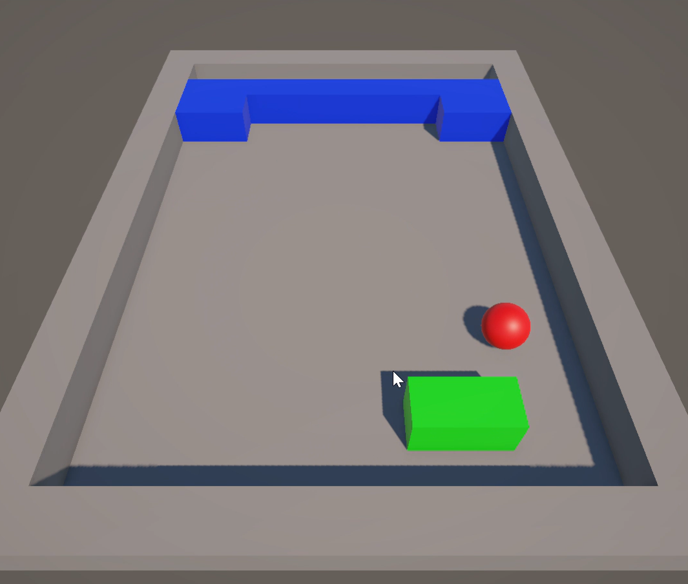

# Brock_kuzushi

Unity で作成したシンプルな 3D ブロック崩しゲームです。

## 概要

パドルを左右に動かしてボールを跳ね返し、ブロックをすべて壊すことを目指すゲームです。

## 動作環境

- Unity 6 (6000.3.10f1)
- Universal Render Pipeline (URP)

## 遊び方

1. Unity Hub からこのプロジェクトを開きます。
2. `Assets/game.unity` シーンを開き、再生ボタンを押します。
3. キーボードでパドルを操作します。

| キー | 操作 |
| --- | --- |
| ← (左矢印) | パドルを左に移動 |
| → (右矢印) | パドルを右に移動 |

## スクリプト構成

| ファイル | 内容 |
| --- | --- |
| `Assets/Player.cs` | 矢印キーでパドルを左右に移動（移動範囲は x = -4 〜 4） |
| `Assets/Ball.cs` | 開始時に斜め方向へ初速を与えてボールを発射 |
| `Assets/Block.cs` | ボールが衝突するとブロックを破壊 |

ボールの跳ね返りは `Assets/Ball.physicMaterial` の物理マテリアルで制御しています。

## 今後の予定

現在はまだシンプルなブロック崩しですが、ここから少しずつアレンジを加えていく予定です。

アイデアの一つとして、音楽に合わせてボールが動く「音ゲー風ブロック崩し」にするかどうかを検討中です。